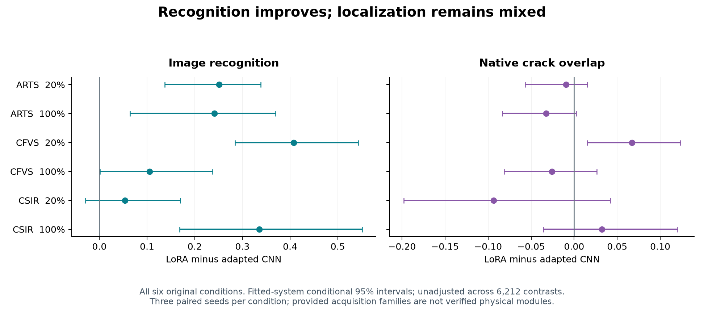

# DINOv3 for solar-cell crack inspection

A concise research handoff for Johnathan. **Start with the findings, then inspect the method and training records.** This is the DINOv3 research study; the separate course midterm report is not included.

**Question:** Can adapting pretrained DINOv3 improve crack inspection with limited masks, and do better image scores also mean better localization and reliable decisions after acquisition changes?

## Start here

| Time | Read | Purpose |
|---|---|---|
| 2 minutes | This page | Question, main findings, status |
| 5–10 minutes | [Results and figures](docs/02_RESULTS.md) | Recognition, localization and transfer failures |
| 10 minutes | [Method and training](docs/03_METHOD_AND_TRAINING.md) | What was trained, losses, budgets, controls and code |
| Full review | [14-page article](paper/main_article.pdf) + [21-page supplement](paper/supplementary_record.pdf) | Complete narrative, real fixed-case maps and detailed architecture |

Need the abbreviations? Read the [data and metric glossary](docs/01_DATA_AND_TERMS.md).

**Visuals in the current paper:** model workflow on page 5, [six-case heatmap comparison](figures/fixed_confirmation_heatmaps.png) on page 11, detailed layers on supplement S20–S21. [Paper guide](paper/README.md).

## Main findings

1. **Recognition gains do not guarantee better localization.** On all six matching held-source SCDD conditions, LoRA has higher mean image AUROC than the adapted CNN, with positive directions in all 18 fitted pairs. Mean positive-image Dice is lower in four of six conditions.
2. **A useful matched-label result has a transfer boundary.** With 86 UCF training masks and 144 validation masks, LoRA obtains confirmation Dice **0.485**, versus **0.369** for the full supervised local port. The same systems transferred to SCDD obtain **0.078 versus 0.096**, despite higher LoRA AUROC.
3. **High recall can hide an unusable operating point.** On restricted PVEL, full-budget SCDD LoRA has known-crack recall **0.952** and author-normal false-positive rate **0.854** at its frozen source threshold.

These are fitted-system comparisons, not an architecture-only causal claim or proof of operational reliability.

All six original conditions. Differences are LoRA minus adapted CNN. Intervals condition on the fitted systems and resample provided acquisition families; they are **unadjusted within 6,212 declared comparisons**. Physical module identity is unverified. [Values, intervals and seed directions](results/held_source_lora_vs_cnn.csv).

## What was done?

- Compared frozen representations, LoRA, full image fine-tuning, CNNs, classical classifiers, normal-reference heads and local supervised/semi-supervised architecture ports.
- Selected rates, checkpoints, image thresholds and temperatures on source development, then used **one frozen confirmation workflow**.
- Completed **1,683 inference jobs and all 6,212 declared contrasts**, saved-output audits and one exact same-host statistical replay.
- Retained **427 recipe families / 1,061 model-or-inference views**, including adverse seeds, unavailable endpoints and fixed population sensitivities. These are not new-architecture or independent-training counts.

See [experiment flow](docs/04_EXPERIMENT_FLOW.md) and [all training records](training/README.md).

## Repository map

| Folder | Contents |
|---|---|
| [docs](docs/02_RESULTS.md) | Short explanations |
| [paper](paper/main_article.pdf) | Article, supplement, source/cost figure companion |
| [figures](figures/README.md) | Reader figures and architecture |
| [results](results/README.md) | Small summary CSVs and exhaustive evidence links |
| [training](training/README.md) | Per-seed configurations, updates and label exposure |
| [reference](reference/README.md) | Exact completed review bundle: code, full tables, atlas, receipts |

**Status:** Frozen scientific work and technical review delivery are complete. Author details, journal-specific finalization and final author approval remain deferred; this is not an already submitted or accepted paper.

**Local audit:** run python3 tools/verify_package.py. It checks bytes, links and coverage without importing research models or running training/inference. See [reproduction limits](docs/05_REPRODUCTION_AND_LIMITS.md).

Scientific results snapshot: 29 October 2026. Current article revision 63 adds visual integration on 2 November; results and scientific choices are unchanged. The exact revision61 reference bundle is preserved. Historical records remain in the [original private handoff](https://github.com/KluK-K/dino-solar/tree/a42e2a4fcb5960d1468a1365e391eb5cc31ed539).
