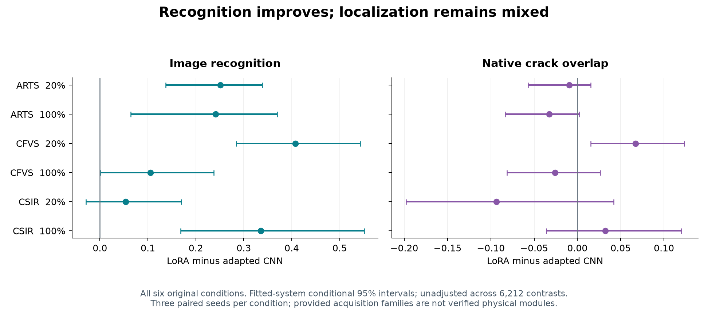
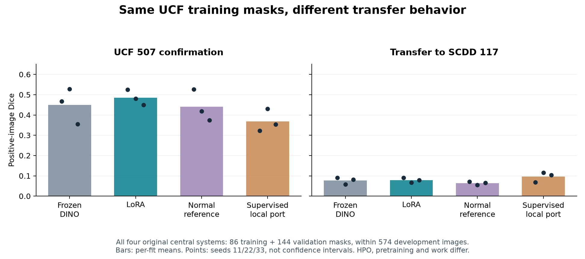

# Results: what is interesting, and where it fails

[Start](../README.md) · [Data terms](01_DATA_AND_TERMS.md) · [Method](03_METHOD_AND_TRAINING.md)

The main finding is an **inspection trade-off**: better image recognition does not consistently produce better crack overlap or portable review decisions.

## 1. All six held-source conditions

Joint dense LoRA versus adapted DeepLabv3+/ResNet-50, on the matching held-source SCDD confirmation stratum. All six original source/budget conditions are retained.

<!-- BEGIN HELD_TABLE -->
| Held source | Budget | CNN AUROC | LoRA AUROC | CNN Dice | LoRA Dice |
|---|---|---:|---:|---:|---:|
| ARTS | 20% | 0.556 | 0.807 | 0.101 | 0.092 |
| ARTS | 100% | 0.616 | 0.857 | 0.134 | 0.101 |
| CFVS | 20% | 0.593 | 1.000 | 0.138 | 0.205 |
| CFVS | 100% | 0.894 | 1.000 | 0.231 | 0.205 |
| CSIR | 20% | 0.878 | 0.932 | 0.273 | 0.179 |
| CSIR | 100% | 0.624 | 0.960 | 0.157 | 0.189 |
<!-- END HELD_TABLE -->

Differences are LoRA minus CNN. All 18 fitted AUROC directions are positive. Dice directions are mixed; CSIR 20% is lower in all three fitted pairs. Five AUROC intervals lie above zero; CSIR 20% crosses zero. The CSV retains original intervals and signs for seeds 11/22/33. These intervals are conditional and unadjusted within the large comparison family, not adjusted-significance or independent-domain claims.

**Interpretation:** Image recognition and native crack recovery can disagree. This does not identify a unique mechanism.

## 2. Matched UCF masks: positive result plus transfer boundary

All four central systems use 86 training masks and 144 validation masks. UCF confirmation values below are per-fit means.

<!-- BEGIN MATCHED_TABLE -->
| System | AUROC | Native AP | Positive Dice | Recall | Review fraction |
|---|---:|---:|---:|---:|---:|
| Frozen DINO | 0.915 | 0.544 | 0.450 | 0.978 | 0.782 |
| LoRA | 0.946 | 0.641 | 0.485 | 0.972 | 0.748 |
| Normal reference | 0.900 | 0.556 | 0.440 | 0.971 | 0.810 |
| Full supervised port | 0.898 | 0.595 | 0.369 | 0.972 | 0.797 |
<!-- END MATCHED_TABLE -->

LoRA versus the full supervised local port has UCF Dice difference **0.116**, conditional unadjusted interval **[0.088, 0.148]**. On SCDD, the same systems have Dice **0.078 versus 0.096**, difference interval **[-0.040, 0.002]**, despite image AUROC **0.875 versus 0.604**.

**Interpretation:** The UCF result is worth discussing, but it is not uniform cross-cohort improvement. Matching masks does not match HPO, pretraining or optimizer work. Frozen DINO and normal-reference systems remain visible.

## 3. Restricted PVEL: source thresholds transfer poorly

The article's three original dense source regimes. Each cell is CNN / LoRA; thresholds remain source-selected.

<!-- BEGIN PVEL_TABLE -->
| Source regime | Known-crack recall | Author-normal FPR | Box-point hit |
|---|---:|---:|---:|
| SCDD 20% | 1.000 / 0.996 | 1.000 / 0.981 | 0.247 / 0.363 |
| SCDD 100% | 1.000 / 0.952 | 1.000 / 0.854 | 0.542 / 0.359 |
| UCF 100% | 1.000 / 0.945 | 0.999 / 0.848 | 0.345 / 0.247 |
<!-- END PVEL_TABLE -->

Full-budget SCDD LoRA recovers **95.2%** of accepted crack positives while flagging **85.4%** of author-normal images. Box-point recovery is mixed too.

**Interpretation:** This does not demonstrate a useful autonomous inspection policy. The population is constructed rather than an estimate of field prevalence. PVEL has no verified capture-family CI or mask-Dice claim.

## 4. Supporting evidence

- **Internal SCDD confirmation:** higher LoRA AUROC at all four budgets; Dice improves at 5%, falls at 10%/100%, and is close at 20%. The 5% gain also increases normal-structure FPR.
- **Normal-reference mechanisms:** mixed effects; equal decoder slots do not identify a matching-specific cause.
- **Native failures:** all 496 mask jobs remain in fixed crack-area strata. High image recall can coexist with zero overlap. All 116 empty native subgroups retain null rates.
- **Cost:** source SCDD/batch-one dense latency is 31.73 ms/image for LoRA versus 27.08 for CNN, with mixed fitted-pair directions. Fewer trained parameters do not establish faster inference. The 97 cost cases do not time every later confirmation checkpoint.
- **Separate ELPV development supplement:** mean outer AUROC 0.904918 for DINOv3 CLS + RBF SVM versus 0.838261 for HOG/statistics + RBF SVM. These are expert-review labels and overlapping development folds, not crack-localization confirmation or a CNN comparison.

See the [source/cost companion](../paper/source_and_cost_figures.pdf), [supplement](../paper/supplementary_record.pdf) and [complete tables](../results/README.md). Development numbers are not confirmation outcomes.

All 6,212 original comparisons remain available. Reader figures summarize the original central article controls; they add no model, threshold, population, contrast or favorable-image selection.
