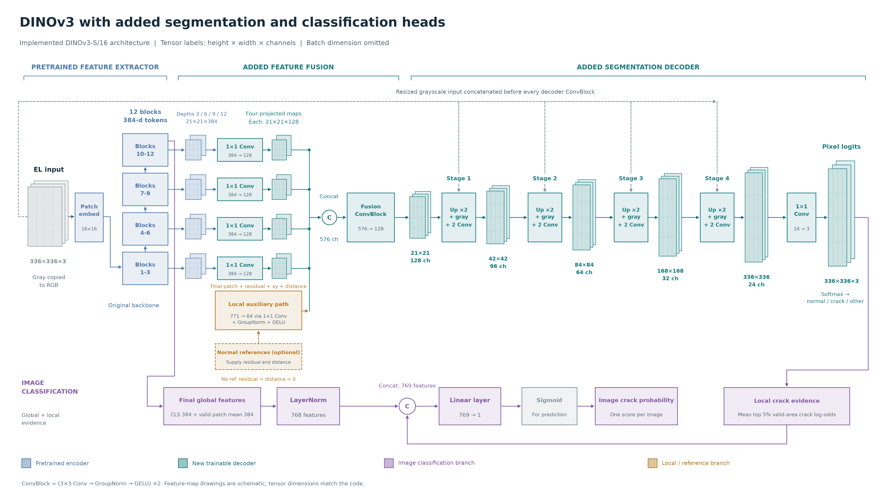

# What the model is, and what was trained

[Start](../README.md) · [Results](02_RESULTS.md) · [Training ledgers](../training/README.md)

## Main model

The encoder is **DINOv3 ViT-S/16**: 12 transformer blocks, 384-dimensional features. A whole grayscale EL image is letterboxed to 336×336, copied into three channels and normalized using the pretrained convention. The patch grid is 21×21; register tokens do not become image positions.

The schematic is traced from existing code. Tensor volumes are schematic, not raw EL pixels or prediction examples.

Two outputs:

1. **Segmentation:** read depths 3/6/9/12, project each map to 128 channels, fuse with a 64-channel local path, then four upsampling/convolution stages. Output: normal/crack/other logits, restored to native coordinates for evaluation.
2. **Image classification:** final CLS + valid-patch mean (768 features), non-affine LayerNorm, one scalar of top-5% local crack evidence, then a linear 769→1 head.

The selected depths share a spatial grid; they are not four native image resolutions. Bilinear upsampling has no learned weights.

## LoRA and output heads are different

| Setting | Encoder | Output components |
|---|---|---|
| Frozen dense DINO | Fixed | Decoder/image head trained |
| Dense LoRA | Original weights fixed; rank-8, scaling-8 Q/V adapters in last four blocks | Decoder/image head trained |
| Full image fine-tuning control | Encoder updated | Image head trained; separate image-only protocol |
| Normal-reference arm | Compatible frozen encoder and source normal memory | Matched local/decoder slots trained |

LoRA changes projections inside existing transformer blocks. Adding output heads is separate. The Small-model LoRA factors add 49,152 parameters, not the total trainable count of the dense system.

The no-reference decoder retains the local slot with zero residual/distance inputs. The reference arm retrieves five eligible source normal images from a capped memory and excludes the query's provided capture family. Post-adaptation controls rebuild compatible memories and fresh heads; their extra work is retained.

## Training recipes

| Pipeline | Objective | Optimization and checkpoint |
|---|---|---|
| Image-only neural | Image BCE | AdamW, batch 8; source-validation AUROC |
| Joint dense DINO / adapted CNN | Image BCE + weighted pixel CE + 0.5×crack soft-Dice | AdamW, batch 2; source sampled pixel AP, then native evaluation |
| Full supervised / semi-supervised local ports | Released PS-MT/PV-S3 architecture, adapted to the local three-class whole-field task; teacher/VAT/consistency controls | SGD, momentum 0.9, polynomial LR, batch 2; original source selection |
| Classical / frozen-vector probes | HOG/statistics or pretrained vectors with classical classifiers | Separate source-only solver/hyperparameter selection |

Image/joint dense AdamW uses weight decay 0.0001, 50 updates per round, at most 40 rounds and patience 6. Rates vary by source-selected recipe. D4 transforms preserve image/mask geometry; unknown/padded pixels do not enter eligible losses.

Dense checkpoint AP samples at most 8,192 fixed known transformed pixels per validation image. Final scores use full eligible native masks. Image thresholds and temperatures are source-selected before confirmation.

Full architecture ports use max(50, ceil(full source-training pool / 2)) updates per round, even at partial labelled budgets. Recorded work spans 1,000–8,600 updates versus 350–2,000 for image/joint-dense records. These are not matched-compute comparisons. Teachers/ensembles share training.

## Labels, seeds and controls

- SCDD internal budgets: 18/36/70/351 training images, plus 120 validation masks and upstream selection exposure.
- Held-source SCDD: ARTS/CFVS/CSIR, each at 20%/100% source budget; matching confirmation strata have 43/27/47 images.
- Matched UCF 20%: 86 train + 144 validation masks inside 574 development images. Semi-supervised arms additionally use the remaining 344 source-training images without reading their masks.
- Seeds 11/22/33 where declared. Partial-budget seeds change training subsets and optimization randomness.
- Controls include frozen/LoRA/full image adaptation, stronger CNN rates, representation/scale choices, patch heads, references, full-method ports and numerical sensitivities.

## Read the implementation

| Inspect | Frozen source |
|---|---|
| DINO loading / LoRA injection | [encoders.py](../reference/completed_review_bundle/code/frozen_20261027/workspace/elpv_research/elresearch/encoders.py), [adapt.py](../reference/completed_review_bundle/code/frozen_20261027/workspace/elpv_research/elresearch/adapt.py) |
| Decoder / image head | [full_models.py](../reference/completed_review_bundle/code/frozen_20261027/workspace/elpv_research/elresearch/full_models.py), [dense construction](../reference/completed_review_bundle/code/frozen_20261027/workspace/elpv_research/elresearch/publication_dense_models.py) |
| Dense training | [publication_dense_train.py](../reference/completed_review_bundle/code/frozen_20261027/workspace/elpv_research/elresearch/publication_dense_train.py) |
| Full local ports | [published_train.py](../reference/completed_review_bundle/code/frozen_20261027/workspace/elpv_research/elresearch/published_train.py) |
| Statistical workflow | [confirmation_analysis.py](../reference/completed_review_bundle/code/frozen_20261027/workspace/elpv_research/elresearch/confirmation_analysis.py) |
| All recipes/seeds | [1,061 sanitized records](../training/all1061_source_recipe_records_sanitized.csv) |

The ledger includes configuration JSON, applicable rates, parameters, completed/selected rounds, updates and label exposure. Counts are not total HPO cost, independent replications or annotation labour. Raw pause-contaminated timers are not converted to active-compute estimates.
