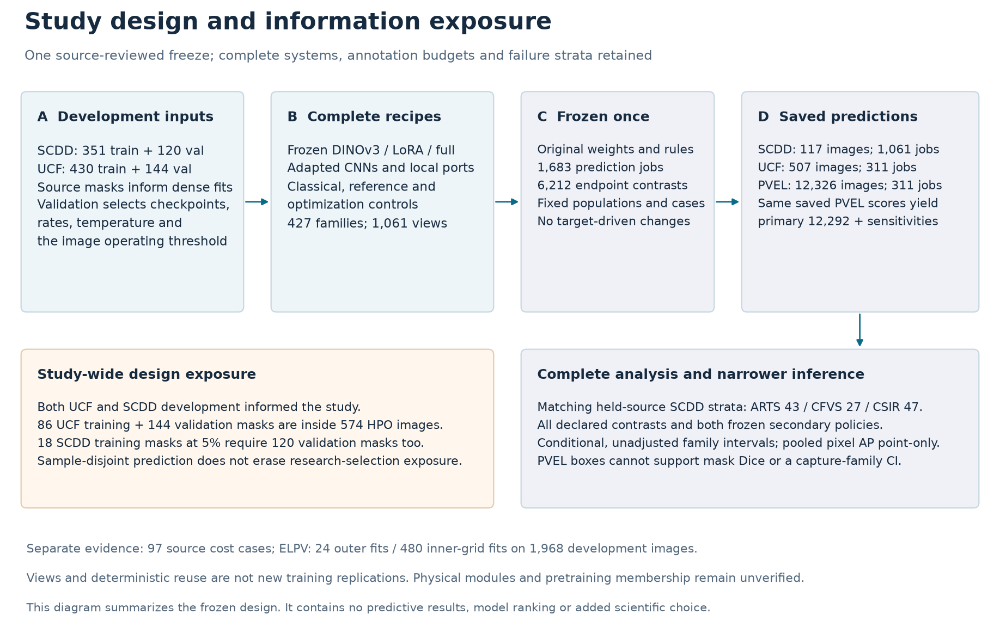

# How the study progressed

[Start](../README.md) · [Method](03_METHOD_AND_TRAINING.md) · [Reproduction](05_REPRODUCTION_AND_LIMITS.md)

## Six stages

1. **Audit inputs.** Map crack/normal/other labels, isolate conflicting identities and duplicates, establish acquisition grouping, inspect PVEL near-copy candidates. Physical modules remain unverified.
2. **Select on source development.** Fit image/classical/dense systems and controls; select rates, checkpoints, thresholds and temperatures on source data. Both UCF and SCDD development inform study-wide design.
3. **Finish controls.** Complete all original source training, full-method local ports, formal source efficiency and separate ELPV development schedules. Retain weak seeds and failures.
4. **Freeze once.** Bind 427 families, 1,061 views, 1,683 model/cohort jobs and 6,212 contrasts. Models, rules, populations and fixed examples precede predictive access.
5. **Score and audit.** Complete all jobs and saved-output audits. Score PVEL's 12,326 pool once per declared view; derive primary and sensitivities from the same predictions.
6. **Analyze completely.** Retain all contrasts, native failures, calibration and population diagnostics. A single registered same-host statistical replay matches the original saved-output analysis except generation time.

| Work | Completed scope |
|---|---|
| Source/control schedules | Complete; [schedule guide](../training/README.md) |
| Frozen inference and audits | 1,683 / 1,683 |
| Declared comparisons | 6,212 / 6,212 |
| Reporting | 16,140 fitted pairs; 2,480 native subgroups; 3,686 absolute cells; 29 overlapping themes |
| Saved-output replay | Same host/environment/implementation; no new inference |
| Current article | Revision 63; 14 main + 21 supplement pages reviewed; workflow and fixed-case heatmaps integrated |
| Formal submission | Author details and journal-specific finalization deferred |

The catalogue has 317 three-seed families and 110 deterministic full-budget singletons. Inference views can share a trained model; 1,061 views are not 1,061 new trainings.

## Historical record

The [original private repository](https://github.com/KluK-K/dino-solar/tree/a42e2a4fcb5960d1468a1365e391eb5cc31ed539) retains the 19 October snapshot and append-only updates, including original failures, reporting repairs and pauses.

This repository provides a concise entry to the completed state. It does not rewrite those ledgers. Historical “pending” or “unscored” statements are dated records, not instructions to restart completed work. No new model choice, registry or automation is introduced here.
